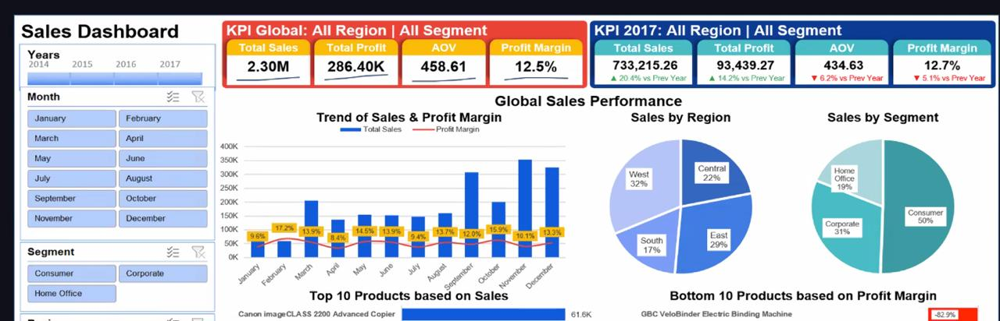

# Thelook Ecommerce Analysis SQL

## Tujuan

- Untuk mengetahui performa penjualan Thelook Ecommerce

## Dataset

**Data Source**: TheLookEcommerce BigQuery

## Pertanyaan

### 1. Berapa jumlah order dengan status complete?

Jumlah order dengan status complete yang tercatat adalah 80.000 order.

### 2. ....

## Key Takeaways

- ada 80.000 order yang complete
- blablabla
